# COFAT Sense — Superviseur de maintenance préventive des tables de contrôle électrique

> Projet réalisé pendant mon stage chez **COFAT** (août 2026) : *Étude et réalisation d'un superviseur artificiel de la fonction d'alerte de la maintenance préventive de la table « TCE »*.

COFAT Sense aide les ingénieurs et techniciens de garde à suivre l'état des **tables de contrôle électrique (TCE)** qui testent les faisceaux de câbles. L'application compte les cycles de test, alerte quand un seuil de maintenance est atteint, guide le technicien avec une checklist d'inspection et calcule un **score de santé** pour chaque machine.

Le projet comprend deux parties :

| Dossier | Contenu | Technologies |
|---|---|---|
| [`web/`](web) | Application web de supervision + liaison Arduino | Python, Flask, SQLAlchemy, Socket.IO, SQLite |
| [`android/`](android) | Application mobile « COFAT Sense » pour les techniciens | Java, Android SDK (min 26), SQLite |

> ⚠️ **Données de démonstration** : toutes les données incluses (machines, références, noms, erreurs) sont **fictives ou anonymisées**. Aucune donnée réelle de l'entreprise n'est publiée.

---

## 📱 Aperçu de l'application Android

| Connexion | Menu | Production | Erreurs machine |
|:---:|:---:|:---:|:---:|
| 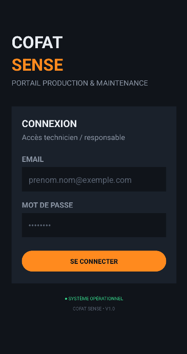 | 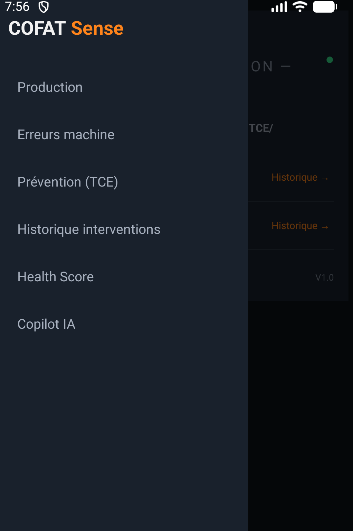 | 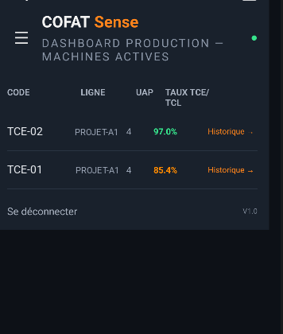 | 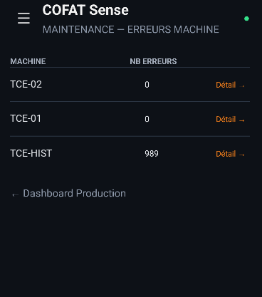 |
| **Prévention (TCE)** | **Comptage des câbles** | **Checklist** | **Interventions** |
| 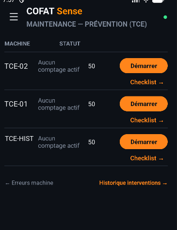 | 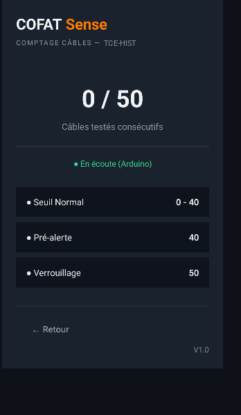 | 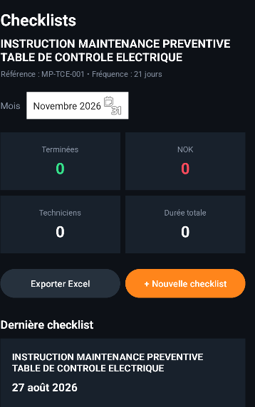 | 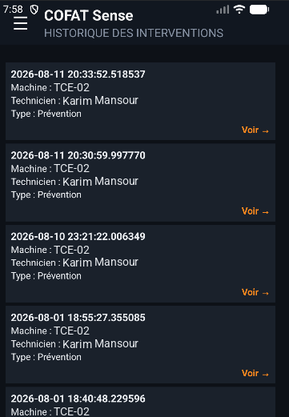 |
| **Historique production** | **Health Score** | **Copilot IA** | |
| 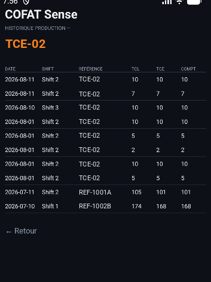 | 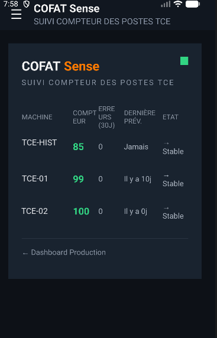 | 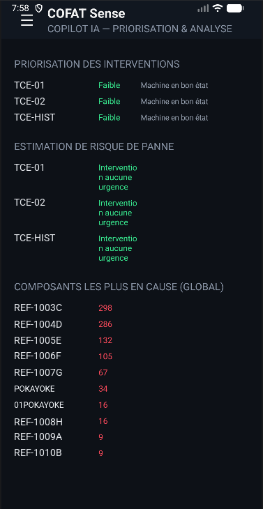 | |

---

## ✨ Fonctionnalités

- **Suivi de production** : historique par machine, poste (shift) et référence.
- **Analyse des erreurs machine** : tableau de bord des tests échoués, rapport d'analyse par machine.
- **Comptage des cycles** : séance de comptage en temps réel (Arduino via port série), blocage automatique de la TCE au seuil de maintenance et notification par e-mail.
- **Maintenance préventive** : checklist d'inspection par organe (OK / NOK), rapport d'intervention, export **PDF** et **Excel**.
- **Score de santé machine (/100)** : calculé à partir de la fréquence des erreurs et du temps écoulé depuis la dernière prévention, avec une tendance.
- **Copilot** : module d'aide à la décision (priorités, risques, composants critiques) et simulation.
- **Rôles** : responsable / technicien, avec authentification.

---

## 🏗️ Architecture

```
 Arduino (compteur)  ──série──►  arduino_listener.py  ──HTTP──►  Application Flask (web/)
                                                                     │
                                                         SQLite (cofat_sense.db)
                                                                     │
                                              Application Android (android/) — base embarquée
```

Modules de l'application web (`web/app/`) :

| Module | Rôle |
|---|---|
| `auth` | Connexion, rôles |
| `production` | Historique de production |
| `maintenance` | Erreurs, comptage, checklists, rapports, PDF, notifications |
| `health` | Score de santé des machines |
| `copilot` | Aide à la décision |

---

## 🚀 Lancer l'application web

```bash
cd web
python -m venv venv
source venv/bin/activate        # Windows : venv\Scripts\activate
pip install -r requirements.txt
python run.py
```

Puis ouvrir http://127.0.0.1:5000

**Comptes de démonstration** (mot de passe `demo2026`) :

| Rôle | E-mail |
|---|---|
| Responsable | `responsable@exemple.com` |
| Technicien | `technicien@exemple.com` |

**Liaison Arduino** (optionnelle) :

```bash
python arduino_listener.py COM7 TCE-02
```

## 📱 Lancer l'application Android

1. Ouvrir le dossier `android/` dans **Android Studio**.
2. Laisser Gradle synchroniser le projet.
3. Lancer sur un émulateur ou un téléphone (Android 8.0+).
4. Se connecter avec un des comptes de démonstration ci-dessus.

---

## 👩‍💻 Auteure

**Rania Ladhari** — Étudiante en Systèmes Embarqués, ISI Ariana
